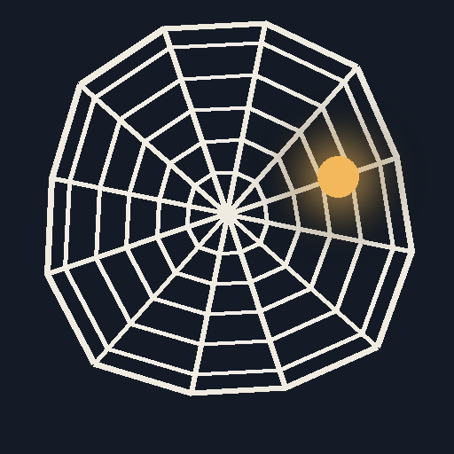
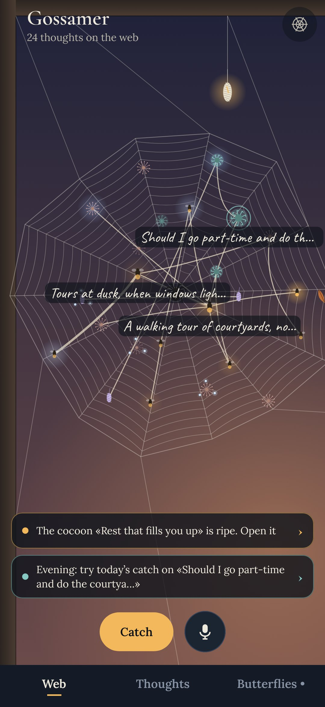
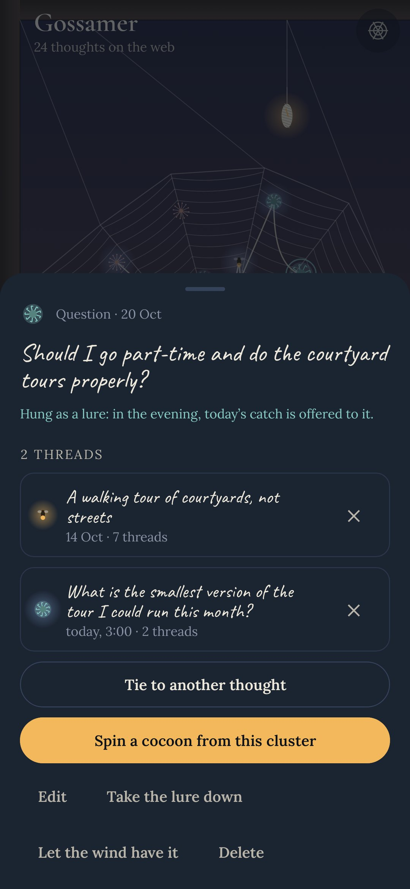
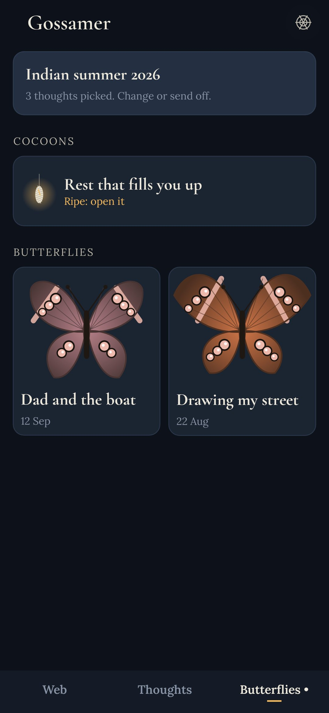
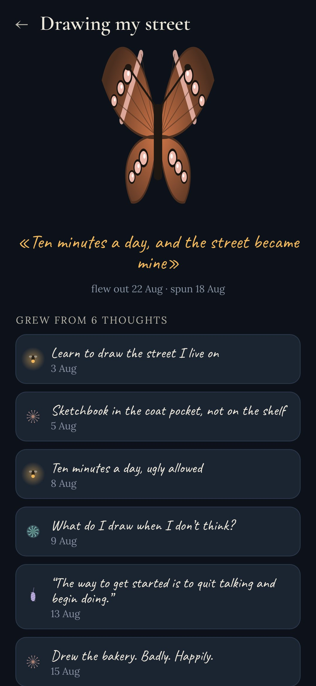

<div align="center">



# Gossamer

### A thought catcher that spins your thoughts into a web

*Catch a thought in two seconds, from anywhere. It sticks to a web drawn in code. Pull threads between thoughts, and the ones with many threads move to the middle: your real themes show by themselves. Dew falls on old thoughts in the morning; the wind takes the untied ones away. When five or more hang together, spin them into a cocoon, and three days later a butterfly flies out. Free, no ads, no internet.*

[](https://github.com/bigdevwhale/gossamer/actions/workflows/android.yml)


[](LICENSE)

**English** · [Русский](README.ru.md) · [Changelog](CHANGELOG.md)

   

**[Download the APK](https://github.com/bigdevwhale/gossamer/releases/latest/download/Gossamer.apk)** · Android 9+

</div>

---

## Catching

- **Two seconds, from anywhere.** The home-screen widget (write or say it), a quick-settings tile, two long-press shortcuts on the icon, «Share» from any app, and selected text («Catch in Gossamer» in the text menu). Voice is recognised right in the sheet by the phone's speech service.
- **One field, four kinds.** A firefly for an idea, a burr for a question, dandelion down for something noticed, a wisp of someone else's silk for words. No titles, no tags, no folders.
- **The night catch.** Thoughts caught after midnight glow, and in the morning the web shows what the night brought.
- **«Caught before».** Write almost the same thing again, and the spider ties it to the old one with a thicker thread. The thoughts that keep coming back are the ones that matter.

## Threads

- **Press a thought and drag a thread to another one.** Or pick from a list, the ones sharing words first.
- Thoughts with three threads or more are pulled in to the hub and keep their words written under them. Nobody sorts anything: the shape of the web is the shape of your thinking.
- **The lure.** Hang an open question («should I change jobs?»). In the evening, the day's catch is offered to it, one tap per thread.

## Dew and wind

- **Morning dew** falls on three old thoughts, the ones untouched longest. Open one and it sparkles.
- **The wind.** An untied thought nobody has opened for a month starts to tremble, then the wind takes it out of the window to **the Fluff**. Nothing is deleted: anything can be put back. The inbox clears itself.

## Cocoons and butterflies

- Five to nine tied thoughts can be **spun into a cocoon** under a name. It hangs from the window frame for three days; no peeking.
- A ripe cocoon is opened by rereading everything inside and writing **one sentence**: a decision, a plan, a first line, a «no».
- Then a **butterfly** flies out. Its wings are drawn from the cocoon's seed and coloured by what was inside, one eye-spot per thought. The collection is the thoughts that grew into something.
- **Indian summer.** In September, gossamer drifts across the glass and you pick the year's twelve thoughts.

The window changes with the hour (dawn, day, dusk, a moonlit night) and the season: frost in winter, raindrops in spring, a leaf caught in the web in autumn.

## Privacy

No `INTERNET` permission, no accounts, no analytics. The microphone is asked for only when you first tap it. Everything lives in a database on the phone. Settings save the whole web as Markdown to read anywhere, or as a JSON backup to restore on another phone.

## Build

```
./gradlew assembleDebug                      # app.gossamer.dev
./gradlew assembleDebug -Pdemo               # app.gossamer.demo: a month of thoughts, a ripe cocoon, two butterflies
./gradlew testDebugUnitTest                  # the web's rules: wind, dew, echoes, layout, backups
./gradlew testDebugUnitTest -Prender --tests '*RenderScreens*' && python tools/shots.py   # screenshots
python tools/res.py                          # strings, EN and RU, from one table
python tools/icon.py                         # the launcher icon
```

Kotlin, Jetpack Compose, Room, DataStore. Everything on screen is drawn in code. Fonts: Cormorant, Lora, Caveat (SIL OFL).

Part of [StillCraft](https://bigdevwhale.github.io/stillcraft/), a set of small calm apps.
