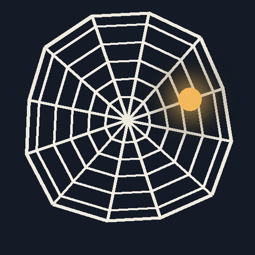
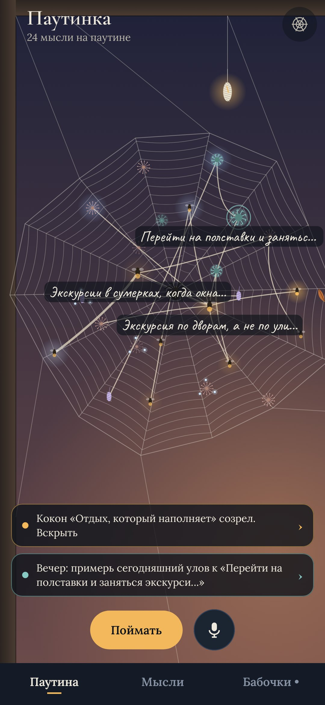
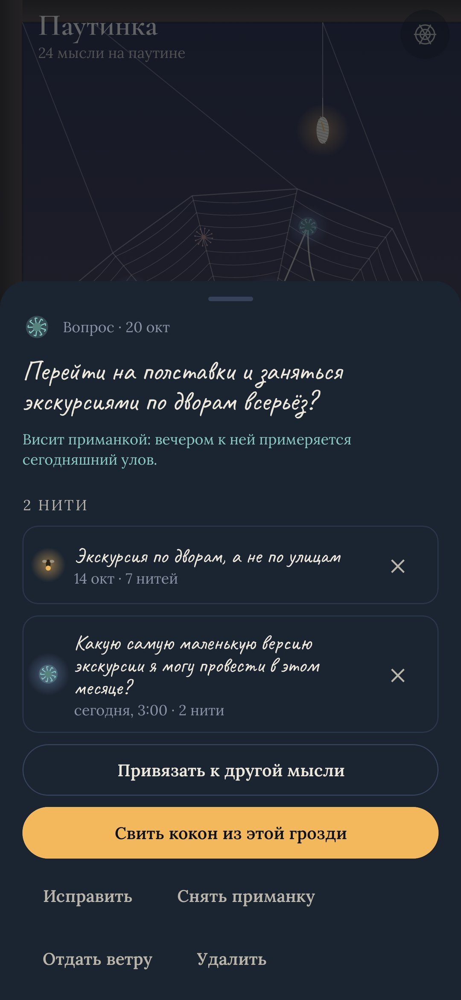
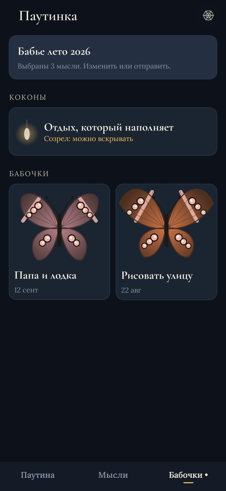
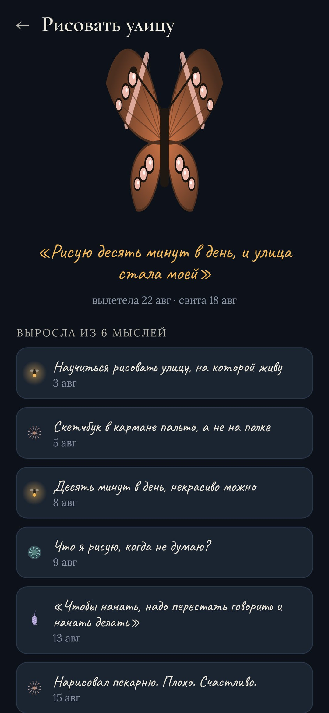

<div align="center">



# Паутинка

### Ловец мыслей, который сплетает их в паутину

*Поймай мысль за две секунды откуда угодно. Она прилипнет к паутине, нарисованной в коде. Протягивай нити между мыслями: те, у кого нитей много, сами переберутся к центру, и проступят твои настоящие темы. По утрам на старые мысли выпадает роса, непривязанные уносит ветер. Когда вместе держатся пять мыслей или больше, сверни их в кокон, и через три дня вылетит бабочка. Бесплатно, без рекламы и без интернета.*

[](https://github.com/bigdevwhale/gossamer/actions/workflows/android.yml)


[](LICENSE)

[English](README.md) · **Русский** · [Изменения](CHANGELOG.md)

   

</div>

---

## Ловля

- **Две секунды, откуда угодно.** Виджет на главном экране (написать или сказать), плитка в шторке, два ярлыка по долгому нажатию на иконку, «Поделиться» из любого приложения и выделенный текст («Поймать в Паутинку» в меню текста). Голос распознаёт сам телефон.
- **Одно поле, четыре вида.** Светлячок — идея, репей — вопрос, пух одуванчика — что-то замеченное, чужая шёлковая ниточка — слова. Без заголовков, тегов и папок.
- **Ночной улов.** Мысли, пойманные после полуночи, светятся, а утром паутина показывает, что принесла ночь.
- **«Уже ловил».** Запишешь почти то же самое ещё раз — паук привяжет новую мысль к старой толстой нитью. Мысли, которые возвращаются, и есть важные.

## Нити

- **Зажми мысль и протяни нить к другой.** Или выбери из списка: сначала те, у кого общие слова.
- Мысли с тремя нитями и больше перебираются к центру, и под ними видны их слова. Никто ничего не сортирует: форма паутины и есть форма твоих мыслей.
- **Приманка.** Повесь открытый вопрос («менять ли работу?»). Вечером к нему примеряется дневной улов, одно нажатие — одна нить.

## Роса и ветер

- **Утренняя роса** выпадает на три старые мысли, к которым ты дольше всего не возвращался. Открой — и она блеснёт.
- **Ветер.** Непривязанная мысль, которую месяц никто не открывал, начинает трепетать, а потом ветер уносит её за окно, в **Пух**. Ничего не удаляется, любую мысль можно вернуть. Входящие разбираются сами.

## Коконы и бабочки

- От пяти до девяти связанных мыслей можно **свернуть в кокон** и дать ему имя. Три дня он висит на раме окна, подглядывать нельзя.
- Созревший кокон вскрывают так: перечитываешь всё, что внутри, и пишешь **одну фразу** — решение, план, первую строчку, «нет».
- И вылетает **бабочка**. Её крылья рисуются из зерна кокона и окрашены тем, что было внутри, по глазку на каждую мысль. Коллекция бабочек — это мысли, из которых что-то выросло.
- **Бабье лето.** В сентябре по стеклу летит паутинка, и можно выбрать двенадцать мыслей года.

Окно меняется с часом (рассвет, день, сумерки, ночь с луной) и временем года: зимой иней, весной капли, осенью в паутине застревает лист.

## Приватность

Нет разрешения `INTERNET`, аккаунтов и аналитики. Всё хранится в базе на телефоне. В настройках можно сохранить всю паутину текстом (Markdown) или резервной копией (JSON) и восстановить её на другом телефоне.

## Сборка

```
./gradlew assembleDebug                      # app.gossamer.dev
./gradlew assembleDebug -Pdemo               # app.gossamer.demo: месяц мыслей, созревший кокон, две бабочки
./gradlew testDebugUnitTest                  # правила паутины: ветер, роса, повторы, раскладка, копии
./gradlew testDebugUnitTest -Prender --tests '*RenderScreens*' && python tools/shots.py   # скриншоты
python tools/res.py                          # строки EN и RU из одной таблицы
python tools/icon.py                         # иконка
```

Kotlin, Jetpack Compose, Room, DataStore. Всё на экране нарисовано в коде. Шрифты: Cormorant, Lora, Caveat (SIL OFL).

Часть [StillCraft](https://bigdevwhale.github.io/stillcraft/) — набора небольших спокойных приложений.
